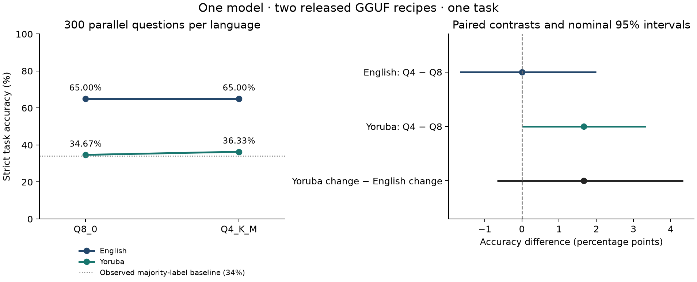

# Quantization and language: a paired AfriXNLI analysis

**One model, one task, two languages, two released GGUF configurations.**

I narrowed this study on **2 November 2026** after inspecting the broader benchmark results. This is an exploratory analysis for methodological review, not a preregistered experiment or a completed paper.

## Question

For Qwen2.5-1.5B-Instruct on this CPU setup, does the Q4_K_M-minus-Q8_0 accuracy change differ between Yoruba and English on AfriXNLI?

## Bounded finding

On **300 parallel questions**, the estimated Yoruba-minus-English difference in accuracy change is **+1.67 percentage points**, with a nominal paired 95% interval of **−0.67 to +4.33**. The interval spans zero. These records do not establish a greater Yoruba compression penalty or equivalence.

| Input language | Q8_0 | Q4_K_M |
| --- | ---: | ---: |
| English | 195 / 300 · 65.00% | 195 / 300 · 65.00% |
| Yoruba | 104 / 300 · 34.67% | 109 / 300 · 36.33% |



**A substantial task limitation:** neither Yoruba configuration predicts the neutral class at all. English neutral recall is poor too. The observed majority-label baseline is 34%. All 1,200 final responses are parseable and none hits the output cap, so those two mechanisms do not explain these accuracy values. One failed request is retained before its successful retry.

## What I controlled, and what I did not

The existing records match the selected parallel questions, original scorer, English instructions/answer labels, output budget, pinned runtime binary and recorded two-thread CPU setup. The analysis independently rescores every response, verifies hashes, retains failures and resamples all four outcomes together by question ID.

The configurations ran sequentially on different dates on a shared server. Q4_K_M and Q8_0 differ in recipe as well as nominal precision; Q8_0 is also compressed. Full upstream conversion/calibration lineage is not recorded. The benchmark translations have not received an independent native audit in this study. I therefore make no pure bit-width, general language-understanding, latency or cost claim.

## Review materials

- [Revised protocol and scope boundaries](report/focused-study/protocol.md)
- [Three-page review note (PDF)](report/focused-study/Inioluwa-Quantization-Review-Note-2026-11-02.pdf)
- [Results, uncertainty and class-level diagnostics](report/focused-study/results.md)
- [Machine-readable results](report/focused-study/results.json) and [300 paired outcomes](report/focused-study/paired-results.csv)
- [Analysis specification](report/focused-study/analysis-plan.json) and [hashed runtime evidence](report/focused-study/provenance.json)
- [Proposed confirmation using the unused 300-question complement](report/focused-study/confirmation-plan.json)—no confirmation predictions collected

## Reproduce

Use Python 3.12 from the repository root:

```bash
pip install -e '.[dev,review]'
python -m bench.data
python -m bench.focused_nli
python -m bench.focused_review
pytest -q
```

Data preparation reads revision-pinned public IrokoBench datasets and must reproduce the original audited selection hash. The two analysis commands make no model requests. They verify immutable Q4/Q8 run snapshots, regenerate paired metrics/CSV/chart, and build the review note. The PDF renderer uses DejaVu Sans fonts; its font directory is configurable.

## Earlier exploratory benchmark

The wider CPU/GPU/API inventory, mobile-payload cost scenarios, other tasks/models and translation intervention are documented in the [archived broader overview](report/broad-benchmark-overview.md), [dated report](report/report.md), [original CPU protocol](report/workspace-protocol.md) and [completion tracker](report/completion.md). Their observations are not pooled into this analysis. Phone/laptop measurement remains outside the workspace study. The raw observations, original protocol and historical counts are preserved.
