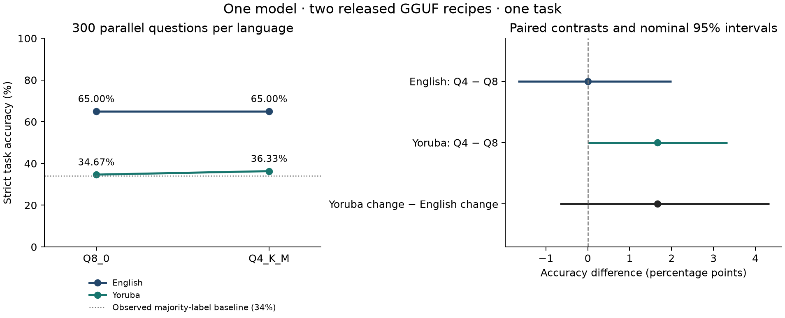

# Paired AfriXNLI analysis: results

**Inioluwa Atanda · 2 November 2026 · Exploratory; no new inference.**

## One bounded finding

The estimated Yoruba-minus-English difference in Q4_K_M-minus-Q8_0 accuracy change is **+1.67 pp [-0.67, +4.33]** on 300 parallel questions. The nominal paired 95% interval spans zero. These records do not establish a greater Yoruba compression penalty, equivalence, or a causal effect of bit width.

| Input language | Configuration | Correct / 300 | Accuracy | Failed attempts |
| --- | --- | ---: | ---: | ---: |
| eng | Q8_0 | 195 / 300 | 65.00% | 1 |
| eng | Q4_K_M | 195 / 300 | 65.00% | 0 |
| yor | Q8_0 | 104 / 300 | 34.67% | 0 |
| yor | Q4_K_M | 109 / 300 | 36.33% | 0 |

| Paired contrast | Estimate and nominal 95% interval |
| --- | --- |
| English: Q4 minus Q8 | +0.00 pp [-1.67, +2.00] |
| Yoruba: Q4 minus Q8 | +1.67 pp [+0.00, +3.33] |
| Yoruba change minus English change (primary) | +1.67 pp [-0.67, +4.33] |

Equal English accuracy does not mean identical answers: four questions are correct only in Q4, and four only in Q8. For Yoruba those counts are six and one. Pairing retains this information.

## Class-level failure

| Language | Configuration | Entailment recall | Neutral recall | Contradiction recall |
| --- | --- | ---: | ---: | ---: |
| eng | Q8_0 | 98.99% | 0.98% | 96.97% |
| eng | Q4_K_M | 94.95% | 4.90% | 96.97% |
| yor | Q8_0 | 96.97% | 0.00% | 8.08% |
| yor | Q4_K_M | 95.96% | 0.00% | 14.14% |

Both Yoruba configurations make zero neutral predictions. English neutral recall is also poor. Each language has 99 entailment, 102 neutral and 99 contradiction gold labels; the observed majority-label baseline is 34%. Yoruba predictions heavily favour entailment. This limits what a quantization comparison near that baseline can tell us.

I have not established whether this pattern comes from model capability, the English-instruction prompt, benchmark translations or another source. I did not change the prompt or select a more forgiving parser after seeing it.

## Format, tokens and request failures

All 1,200 final responses are parseable under the original scorer, and none stops at the output token cap. There is one failed English Q8 request before a successful retry: 1,201 attempts, 1,200 final responses, 300 paired clusters. The failure remains in the immutable source log. Invalid-format answers and output caps therefore do not explain these four observed accuracy values.

Reported prompt-token ranges are 72–124 for English and 92–281 for Yoruba in both configurations. Equal output budgets do not equalise input tokenisation. The setup uses English instructions and answer labels with translated premises and hypotheses; it is not a fully Yoruba interaction.

## Interpretation limits

I chose this narrower analysis after inspecting the broader results. The conditions ran sequentially on different dates on shared hardware. The paired bootstrap captures question variation, not execution drift or repeat variability. Both artifacts share a pinned official GGUF release, but their complete upstream conversion/calibration lineage is not recorded. Q4_K_M and Q8_0 are different quantization recipes; Q8_0 is not an uncompressed control. AfriXNLI translation quality has not received an independent native audit in this study.

## What I changed and what remains

I have narrowed the question, matched the four cells by question ID, independently rescored outputs, added paired intervals and class diagnostics, preserved failures, and excluded provider/hardware/cost comparisons from the main claim. Raw observations and the earlier wider protocol are unchanged.

I reserved the disjoint 300-question complement for a possible fresh confirmation. No confirmation run has happened. Balanced condition order, a reserved host, conversion provenance, repeat checks and translation review remain design work to resolve before that experiment. The holdout is from the same benchmark.

See [the revised protocol](protocol.md), [analysis plan](analysis-plan.json), [runtime evidence](provenance.json), [confirmation proposal](confirmation-plan.json) and [paired outcomes](paired-results.csv). Run `python -m bench.focused_nli` and `python -m bench.focused_review` from the repository root. No model requests are made by either command.
