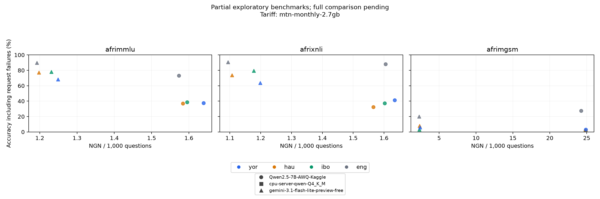

# CPU server or cloud API? The cost of AI in Nigerian languages

Status: Kaggle and first CPU condition complete; other CPU conditions and commercial comparison pending.

The owner changed the target on 2026-10-26 to workspace-only experiments. The
CPU arm uses a shared Linux server, not a consumer device. Phone and laptop runs
are outside the current scope. The [revised protocol](workspace-protocol.md)
records the conditions selected before CPU results.

## Question and data

Which local or cloud option reaches a stated accuracy threshold at the lowest
marginal cost for Yoruba, Hausa, Igbo and English? Use 300 AfriMMLU, 300 AfriXNLI
and all 250 AfriMGSM test items per language. The three pinned dataset releases
yield 3,400 total items. Sampling uses the same seeded row indices across
languages; original gold-answer agreement is checked before evaluation.

## Method

Use identical English instruction templates with language-specific question
content. Record the template version. Require unambiguous canonical answers:
A–D, one of three NLI labels, or a numeric math answer. Invalid answers count as
incorrect; never extract an arbitrary number from reasoning. Temperature is zero,
with the same output budget. Shuffle evaluation order using a fixed seed.

Evaluate two small model families, each at Q4_K_M and Q8_0, a larger model on
a Kaggle vLLM endpoint and a versioned commercial free-tier endpoint. Record model
hash, llama.cpp commit, server hardware, OS, memory, thread budget and competing load.
Run a separate local-translation condition, including translation overhead.

Measure streamed first text, first complete whitespace-delimited word, full
latency, generation rate, process RSS sampled every 50 ms and application-body
bytes. Very short answers can arrive as one chunk, so first-word time can equal
completion time. OS RSS is not a high-frequency hardware memory trace.

## Results and chart

The Qwen2.5-7B-Instruct AWQ run on a Kaggle T4 completed all 3,400 unique items
with 3,400 successful responses and 1,239 correct answers under the fixed
128-token budget. Per-task results avoid pooling unlike tasks:

| Language | AfriMMLU (300) | AfriXNLI (300) | AfriMGSM (250) |
| --- | ---: | ---: | ---: |
| English | 73.00% | 88.00% | 27.60% |
| Yoruba | 37.67% | 41.33% | 3.20% |
| Hausa | 37.00% | 32.33% | 1.60% |
| Igbo | 38.67% | 37.33% | 0.80% |

All 2,400 knowledge/logic responses were parseable and ended normally. For
math, 734 of 1,000 responses ended at the token cap and only 270 were parseable.
The low math scores therefore combine reasoning, language, format-following and
budget limits. A separately declared larger-budget sensitivity run is needed
before attributing the gap to language understanding. The original results are
retained. Provenance records the model revision, vLLM 0.11.2, runtime packages,
evaluation source commit and corpus hash.

Latency is client/server loopback on the Kaggle host, not mobile WAN latency.
The free research quota does not supply a permanent public endpoint. Its
payload-cost scenario can be plotted but is excluded from the final cheapest
deployment decision table.

The first Gemini Flash Lite free-tier batch recorded 450 requests, including 395
successful responses and 55 HTTP 503 failures. Of those 450 attempted items, 237
were answered correctly. This is a shuffled partial sample, not the final
language/task comparison. Results retain all request failures and retries.
The second daily batch brings the snapshot to 900 attempts and 845 unique
items, each now with a successful response; 480 are correct. The 55 initial
503 failures remain in retry and byte accounting. This is still partial and
cannot replace the complete per-language/task comparison.
The fixed 48-question shared-Linux pilot is an integration check, excluded from
the full CPU-server comparison.

The latest immutable snapshot contains 1,350 commercial attempts across
1,295 unique items, with 1,278 successful responses. Seventeen attempted items
still need request-error retries; all attempts remain in payload accounting.
These partial results do not qualify for final recommendations.

### First full CPU condition

Qwen2.5-1.5B Q4_K_M completed all 3,400 items: 744 strictly correct responses
(21.88%), with three request errors retained and subsequently recovered. The
source remains pinned to `c75b734`, with two CPU threads and the original data.

| Language | AfriMMLU (300) | AfriXNLI (300) | AfriMGSM (250) |
| --- | ---: | ---: | ---: |
| English | 13.67% | 65.00% | 0.80% |
| Yoruba | 16.33% | 36.33% | 0.00% |
| Hausa | 24.67% | 35.67% | 0.40% |
| Igbo | 22.00% | 33.33% | 0.00% |

These are strict answer-delivery rates. Only 105/300 English knowledge outputs
were parseable; many others returned an option letter plus its text instead of
the requested canonical answer. An explicitly post-hoc diagnostic accepts only
an exact option string, optionally prefixed by its matching letter. It recovers
103 additional correct English knowledge outputs, yielding 48.00%. The same
diagnostic gives 24.33%, 27.67% and 26.67% for Yoruba, Hausa and Igbo knowledge
questions respectively. It makes no new requests, does not extract arbitrary
letters from explanations and does not replace the primary scores. This
separates some formatting failures from content errors, rather than supplying
an independent confirmatory result.

Math hit the output limit on 837/1,000 CPU requests, including 230/250 English
requests. Only 63/1,000 math outputs were parseable. These strict scores do not
isolate mathematical or language competence.

Accuracy snapshots preserve successful responses without rerunning incorrect
answers. Timing repetitions and warmups are excluded from main accuracy reports.
The active run had a documented storage interruption and later monitoring pause;
it is not an uninterrupted timing session. Three fixed-sample timing repeats
remain necessary. `result-inputs.json` records exact files and snapshot hashes;
never combine a live file and its snapshot as independent attempts.

`bench.report` generates
`report/results/summary.csv`, `accuracy-cost.png` and `decisions.json` from measured
run files. The predeclared example accuracy threshold is 60%; revise it only with
an explicit reason before inspecting final comparisons. If no option reaches it,
the decision table reports no eligible option.

Reproduce this snapshot with the paths in `report/result-inputs.json` and
`--billing configs/billing.free-tier.json`. Reports include parseable answers,
length-limited outputs, client/server RSS and observed attempt service seconds
per 1,000 questions. Service time excludes controller downtime, warmups, idle
provisioning and commercial rate-limit waits.

## Cost

Use decimal MB and unrestricted bundle volumes. Checked 2026-10-25: MTN's
NGN 2,000 / 2.7 GB bundle, Airtel's NGN 2,000 / 3 GB bundle, and MTN PAYG at
NGN 3.07/MB. These imply about NGN 0.741/MB, 0.667/MB and 3.07/MB, respectively.
Official pages and exclusions are recorded in `configs/tariffs.json`.

For a cloud option, `1000 × MB/question × NGN/MB` is added to observed token
billing or measured self-hosted inference cost. A USD price requires a separately
sourced, dated exchange rate. Free-tier scenarios must be labelled and quota
limited. The current byte measure excludes transport overhead and therefore is
not exact billed data consumption. Initial model downloads, power, hardware,
idle server time, unsuccessful calls and bundle expiry need separate accounting.
The workspace's hosting price is not available. Its compute cost is unknown,
and CPU-server results cannot be assigned the zero marginal API/data cost used
for an already-downloaded model on a personally owned offline device. Tariff
calculations for loopback-hosted endpoints are hypothetical user-access payload
scenarios, not measurements of a Nigerian network connection.

## Translation, error analysis and limitations

Review a language-balanced sample of translation and answer-extraction failures.
Report math, knowledge and NLI separately. English prompting, training-data
contamination, correlated parallel items, thermal throttling and mobile network
variability limit interpretation. Do not generalize a workstation result to a
phone or a free API allowance to sustained commercial serving.

## Conclusion

The datasets, reproducible evaluator and cost model are ready. Complete CPU/cloud runs,
repeated performance measurements and translation review are needed before an
accuracy/cost trade-off or final CV percentage can be reported.
